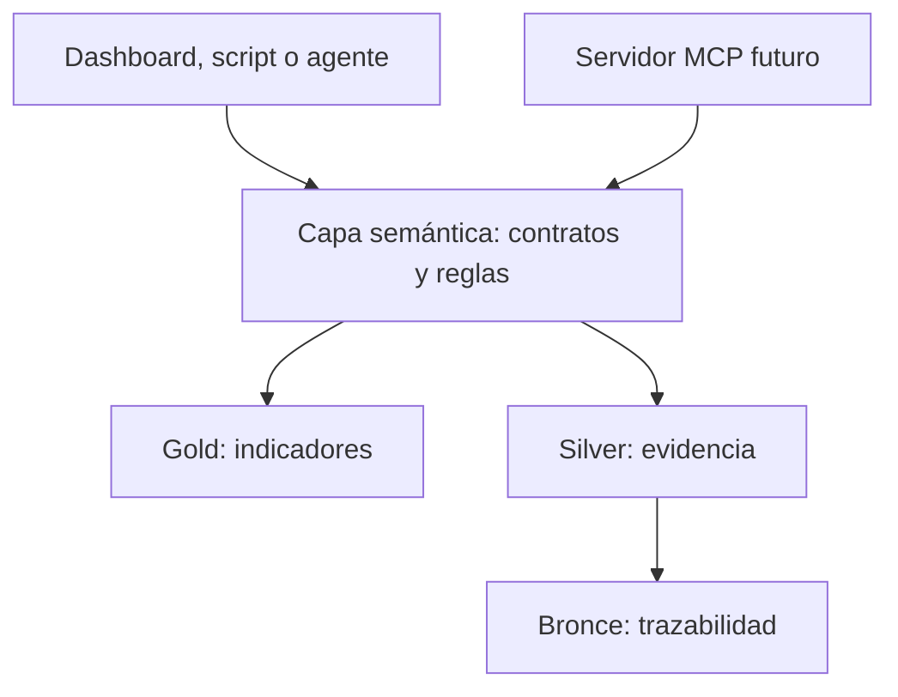

# Instrucciones para implementar la capa semántica de noticias

## 1. Objetivo y alcance

Construir una interfaz de consulta que traduzca los datos gold a conceptos de negocio comprensibles, con reglas explícitas y resultados verificables. Debe servir a dashboards, scripts y agentes sin obligarlos a interpretar nombres técnicos ni a volver a descargar noticias.

Este documento es una guía de implementación. Los archivos, funciones y contratos propuestos a continuación todavía deben crearse; escribir esta guía no los implementa.

La capa semántica debe responder preguntas como:

- ¿Cuál es el sentimiento de las noticias de WALMEX calculado hoy?
- ¿Cuántos artículos respaldan ese resultado y qué periodo cubren?
- ¿Cómo cambió el resultado entre dos fechas comparables?
- ¿Qué noticias sobre Trump sustentan el indicador temático?
- ¿Los datos corresponden a hoy o están desactualizados?

No debe inferir que una noticia política afecta a una empresa sin evidencia ni convertir sentimiento en una probabilidad de subida o recomendación de compra.



MCP es un mecanismo para exponer herramientas al agente. La capa semántica define lo que esas herramientas significan y cómo obtienen sus respuestas. Debe funcionar primero sin MCP.

## 2. Fuentes de datos existentes

Usar como referencia el código de [news_medallion.py](src/data/news_medallion.py) y la [documentación medallion](docs/NEWS_MEDALLION.md).

| Archivo existente | Uso semántico |
|---|---|
| `data/news/gold/today_features.parquet` | Indicadores de la fecha UTC actual. |
| `data/news/gold/historical_features.parquet` | Indicadores conservados por fecha, emisora y tema. |
| `data/news/gold/daily_features.parquet` | Copia compatible de la histórica. No es otra fuente que deba unirse con ella. |
| `data/news/gold/latest.json` | Exportación compatible de la tabla del día. No mezclarla con el Parquet como si fueran registros nuevos. |
| `data/news/silver/articles.parquet` | Observaciones de artículos, fechas y asociaciones para recuperar evidencia. |
| `data/news/bronze/news.parquet` | Registros recibidos sin limpieza adicional, por noticia y captura. |
| JSON de capturas en `data/news/bronze/` | Respaldo completo de los lotes. |

No utilizar `data/news/latest.json`, `data/news/history/daily_features.parquet` o los ejemplos de `data/golden/` como sustitutos silenciosos de las tablas gold nuevas: tienen contratos o procedencias diferentes.

## 3. Modelo de negocio y grano

### 3.1 Entidades

- **Emisora:** identificada por `ticker`, por ejemplo `WALMEX`.
- **Tema:** identificado por `topic`, por ejemplo `trump` o `market`.
- **Artículo:** identificado por `article_id`; puede observarse varias veces.
- **Captura:** identificada por `batch_id`; puede contener muchos artículos.
- **Resultado diario:** indicadores de una asociación en una fecha UTC.

### 3.2 Reglas del grano

La clave lógica gold actual es `(date, ticker, topic)`.

1. Para una consulta empresarial, filtrar el ticker normalizado. Por defecto exigir `topic == ""` para no mezclar asociaciones diferentes; cualquier variante debe pedirse explícitamente.
2. Para una consulta temática, filtrar `topic` y exigir `ticker == ""`.
3. Una fila con `topic="trump"` y ticker vacío no pertenece automáticamente a WALMEX ni a otra empresa.
4. Validar que no existan claves gold duplicadas. No resolver duplicados mediante una suma o selección arbitraria.
5. Silver conserva observaciones repetidas entre lotes; contar sus filas no equivale al número de noticias únicas.

Ejemplo: una misma noticia puede asociarse a dos emisoras. Si se suman sus conteos, se cuenta dos veces el artículo. Para obtener noticias únicas de varias empresas hay que resolver sus identificadores y deduplicarlos.

## 4. Estructura de código propuesta

Crear estos archivos sin mover los módulos actuales de ingesta:

```text
src/semantic/
├── __init__.py
├── models.py           # Contratos de entrada y respuesta
├── metrics.json        # Catálogo de métricas y reglas
├── repository.py       # Lectura y validación de Parquet
├── service.py          # Consultas y aplicación de reglas
└── interpretation.py   # Etiquetas y mensajes derivados
scripts/
└── query_news_semantic.py
tests/
└── test_news_semantic.py
```

Usar `Path` y una raíz de datos inyectable. Los tests deben apuntar a directorios temporales. Puede utilizarse `dataclasses` y `json` de la biblioteca estándar; no hace falta incorporar un framework para esta primera versión.

Responsabilidades:

- `repository.py` entrega datos técnicos validados.
- `service.py` selecciona filas, verifica disponibilidad y devuelve respuestas de negocio.
- `interpretation.py` interpreta únicamente valores con evidencia suficiente.
- Los consumidores llaman a `service.py`, no leen directamente los Parquet.

Evitar dependencias inversas: el servicio no importa el agente ni un servidor MCP.

## 5. Catálogo de métricas

Crear `metrics.json` como contrato versionado. Cada entrada debe incluir `field`, `business_name`, `description`, `unit`, `aggregation`, `null_policy`, `requires_recent_articles` y, cuando proceda, rango esperado.

Ejemplo de una entrada:

```json
{
  "field": "news_sent_score",
  "business_name": "sentimiento_general",
  "description": "Promedio ponderado del sentimiento de noticias recientes",
  "unit": "score",
  "aggregation": "non_additive",
  "null_policy": "unknown_when_no_recent_articles",
  "requires_recent_articles": true,
  "expected_range": [-1, 1]
}
```

Registrar estas definiciones:

| Campo gold | Nombre de negocio propuesto | Significado y regla |
|---|---|---|
| `news_sent_score` | `sentimiento_general` | Sentimiento reciente ponderado. No sumarlo ni interpretarlo como probabilidad. |
| `news_count_7d` | `volumen_informativo_ponderado` | `ln(1 + suma de pesos)`. No es cantidad de artículos ni una métrica aditiva. |
| `news_sent_delta` | `cambio_sentimiento` | Sentimiento reciente menos el de la ventana previa. No es una comparación automática con la fila gold del día anterior. |
| `news_sent_vol` | `dispersion_sentimiento` | Dispersión ponderada entre noticias. No es volatilidad del precio. |
| `news_relevance_avg` | `relevancia_promedio` | Relevancia ponderada de las noticias respecto a la asociación. No es confianza estadística. |
| `news_esg_score` | `sentimiento_esg` | Sentimiento de titulares identificados como ESG, no una calificación de sostenibilidad de la empresa. |
| `n_articles` | `cantidad_articulos` | Conteo de artículos de la ventana reciente después de elegir observaciones únicas; no incluye la ventana anterior. |

Metadatos que deben acompañar a las métricas:

| Campo | Interpretación |
|---|---|
| `date` | Fecha UTC del resultado. |
| `as_of` | Corte exacto de información utilizado. |
| `window_days` | Duración de la ventana reciente; la ventana anterior tiene la misma duración. |
| `scoring_method` | Método de evaluación; actualmente `keywords`. |
| `sources` | Fuentes de artículos de la ventana reciente. |
| `publication_date_missing` | Artículos sin publicación conocida entre las dos ventanas; no es exclusivamente un conteo reciente. |
| `article_ids` | Identificadores de evidencia de ambas ventanas. |
| `batch_ids` | Capturas de las observaciones seleccionadas como evidencia. |

No cambiar el significado de `news_count_7d` cuando `window_days` sea distinto de siete. Mostrar el nombre de negocio junto al tamaño real de ventana.

## 6. Fechas, ventanas y comparabilidad

Implementar estas reglas antes de escribir las consultas:

1. Almacenar y filtrar fechas con zona UTC. Inyectar un reloj en el servicio para poder probar cambios de día.
2. **Hoy** significa el día UTC actual porque así se construyó gold. Mostrar opcionalmente `as_of` en `America/Mexico_City`, pero no convertir una etiqueta de día UTC en una sesión mexicana distinta.
3. En consultas históricas exigir fecha ISO `YYYY-MM-DD`. No sustituir una fecha ausente por la última disponible salvo que el usuario solicite explícitamente una consulta de última observación.
4. Si se recibe una hora de corte, no usar una fila cuyo `as_of` sea posterior. Gold conserva una versión por fecha, no todas las versiones intradía; puede no existir una respuesta para una hora pasada.
5. La tabla del día usa una ventana móvil, normalmente siete días. No significa que todas sus noticias se publicaron hoy.
6. Validar `window_days` y `scoring_method` antes de comparar filas. Si difieren, devolver `incompatible_metrics` o exigir un recálculo externo explícito.
7. No prometer varias ventanas guardadas simultáneamente: la clave gold actual no incluye `window_days`, así que recalcular una fecha con otra ventana reemplaza sus filas.
8. No sumar `n_articles` entre días con ventanas superpuestas. Para un periodo completo hay que recuperar artículos únicos desde silver.
9. Para reproducir ventanas, usar el comportamiento real de `build_gold`: `event_at = published_at` o `fetched_at` cuando falta publicación; primero filtra `available_at <= as_of` y limita los eventos a las dos ventanas. Los cálculos de `news.py` aplican sus propios límites diarios. No implementar límites temporales diferentes dentro del servicio.

## 7. Ausencia, neutralidad y calidad

### 7.1 Valores nulos

- Silver: `text=null` indica que no hay un extracto distinto. Mostrar `title` sin duplicarlo como resumen.
- Silver: `sentiment=null` indica no evaluado; `0` proporcionado por una fuente representa neutralidad.
- Gold calcula su propio sentimiento con palabras clave; no copiar sin más el sentimiento silver para explicar gold.
- Serializar valores ausentes como `null`, nunca como `NaN`, `"None"` o cadenas vacías en campos numéricos.

### 7.2 Falta de artículos recientes

Cuando no hay fila gold, devolver un estado de ausencia, no seis ceros inventados.

Cuando hay fila con `n_articles=0`, puede existir evidencia solo en la ventana anterior. Conservar el registro técnico para auditoría, pero en la respuesta de negocio marcar `no_recent_articles` y no presentar sentimiento reciente, dispersión o relevancia como evaluaciones neutrales reales.

`news_esg_score=0` tampoco demuestra neutralidad ESG. Gold no guarda un conteo ESG: sin verificar los artículos no se puede distinguir entre falta de noticias ESG y un promedio neutral. Indicar `esg_coverage="unknown"` por defecto; una consulta de evidencia puede determinar si había titulares ESG siguiendo la misma función del cálculo.

No afirmar que `news_sent_delta` compara dos ventanas con evidencia si no se verificó también la cobertura anterior en silver. Su fórmula usa cero como respaldo cuando falta una de ellas.

### 7.3 Frescura

Definir un parámetro configurable `max_calculation_age_hours`, por ejemplo 24 horas como valor operativo inicial, sin presentarlo como umbral estadístico.

Separar:

- `calculated_at`: valor `as_of` de gold.
- `calculation_age_hours`: edad del cálculo respecto al reloj de consulta.
- `latest_evidence_fetched_at`: última captura entre la evidencia seleccionada, si se resolvió.
- `evidence_freshness`: `unknown` si no se consultó esa evidencia.

Un cálculo reciente puede usar artículos antiguos. No llamar «fuente actualizada» a una mera regeneración de gold. Un archivo vacío o una fecha sin filas tampoco permiten diagnosticar por sí solos una caída de la API.

## 8. Contratos de respuesta

Implementar una respuesta consistente con `schema_version`, `status`, `query`, `data`, `warnings` y `provenance`.

Estados propuestos:

| Estado | Cuándo usarlo |
|---|---|
| `ok` | Fila válida con artículos recientes. |
| `not_found` | No hay una asociación o fecha con resultados guardados; explicar el alcance de la búsqueda. |
| `no_recent_articles` | Existe la fila, pero `n_articles=0`. |
| `stale` | La fecha de la tabla del día no coincide con hoy o el cálculo supera la edad configurada. |
| `incompatible_metrics` | Ventanas o métodos distintos en una comparación. |
| `invalid_input` | Parámetros mal formados o fuera del contrato. |
| `data_unavailable` | Archivo inexistente o ilegible. |
| `data_integrity_error` | Esquema incorrecto, clave duplicada o evidencia inválida. |

Ejemplo ilustrativo, no extraído del Parquet actual:

```json
{
  "schema_version": 1,
  "status": "ok",
  "query": {"entity_type": "ticker", "entity_id": "WALMEX", "mode": "today"},
  "data": {
    "date_utc": "2026-10-30",
    "as_of": "2026-10-30T17:00:00Z",
    "window_days": 7,
    "scoring_method": "keywords",
    "metrics": {
      "sentimiento_general": 0.15,
      "cantidad_articulos": 8,
      "volumen_informativo_ponderado": 1.2
    },
    "sources": ["databursatil", "google_news"]
  },
  "warnings": [],
  "provenance": {
    "dataset": "gold/today_features.parquet",
    "key": {"date": "2026-10-30", "ticker": "WALMEX", "topic": ""},
    "evidence_available": true
  }
}
```

Las respuestas normales deben limitar evidencia y metadatos extensos. Ofrecer una operación separada para obtener los artículos y una paginación estable.

## 9. Implementar el repositorio de lectura

En `repository.py`:

1. Recibir `news_root: Path`, sin construir rutas desde cadenas proporcionadas por el usuario.
2. Definir métodos `read_today()`, `read_history()` y `read_silver()`.
3. Validar columnas requeridas antes de filtrar; utilizar `GOLD_COLUMNS` y `SILVER_COLUMNS` como referencia del esquema real.
4. Verificar claves gold, tipos temporales UTC, conteos no negativos y métricas finitas donde haya valor.
5. Normalizar las listas `article_ids` y `batch_ids` usando `json.loads`; no usar `eval`.
6. Aceptar listas de fuentes devueltas por Parquet como listas o arrays, y convertirlas a listas de strings para la respuesta.
7. Devolver errores estructurados y registrar el detalle técnico en logs, sin exponer rutas absolutas o contenido de credenciales.
8. No activar ingestas, importaciones ni escrituras al leer.

El reemplazo atómico de cada Parquet permite leer una versión completa de ese archivo. No garantiza una transacción consistente entre gold y silver: si cambia la evidencia durante la consulta, detectar inconsistencias y devolver una advertencia o error, sin afirmar trazabilidad completa.

Para el volumen actual, leer Parquet con pandas es suficiente. Si se agrega caché, invalidarla por cambios del archivo y documentar su vida útil.

## 10. Implementar las consultas del servicio

Firmas propuestas, no funciones ya existentes:

```python
consultar_empresa(ticker, *, fecha=None, window_days=None)
consultar_tema(topic, *, fecha=None, window_days=None)
consultar_historial(entity_type, entity_id, inicio, fin, *, window_days=None)
comparar_fechas(entity_type, entity_id, fecha_a, fecha_b)
consultar_evidencia(entity_type, entity_id, fecha, *, periodo="reciente", limit=20, offset=0)
consultar_cobertura()
```

### 10.1 Empresa o tema

1. Validar el tipo de entrada, quitar espacios exteriores y normalizar ticker a mayúsculas o tema a minúsculas.
2. Rechazar identificadores vacíos. Usar límites de longitud y caracteres permitidos definidos en `models.py`.
3. Si no hay fecha, leer la tabla del día y validar que todas sus filas correspondan a hoy UTC.
4. Si hay fecha, leer histórica y seleccionar coincidencia exacta.
5. Aplicar las reglas de asociación de la sección 3.
6. Si se pidió una ventana específica, verificarla; no sustituirla ni recalcular en silencio.
7. Aplicar estados de disponibilidad y calidad.
8. Traducir nombres técnicos a nombres de negocio y adjuntar el contexto temporal.

No es necesario que un ticker esté en un catálogo externo para devolver datos que efectivamente existen. Si no existe, devolver `not_found` y no afirmar que la empresa es inválida en todos los sistemas.

### 10.2 Histórico y comparación

- Validar `inicio <= fin`, limitar el rango máximo de consulta y ordenar por fecha.
- Conservar huecos; no rellenarlos con ceros ni arrastrar valores como si se hubieran observado ese día.
- En cada comparación verificar ventanas y métodos iguales.
- Si se calcula diferencia de `news_sent_score` entre dos filas, nombrarla `diferencia_entre_fechas`; no confundirla con `news_sent_delta`.
- No calcular promedios generales o rankings de sentimiento sin una regla de agregación explícita. Para empezar, devolver los valores por entidad y fecha.

### 10.3 Evidencia

1. Leer los conjuntos `article_ids` y `batch_ids` del resultado gold solicitado.
2. Filtrar silver por la asociación exacta, disponibilidad hasta `as_of`, identificadores y lotes incluidos.
3. Reproducir los filtros y selección de observaciones de `build_gold`: evento conocido, dos ventanas y última observación disponible por artículo/asociación.
4. Gold guarda dos listas independientes, no los pares exactos artículo-lote. No hacer un producto cartesiano ni devolver todas las observaciones que compartan uno de los identificadores.
5. Distinguir `periodo="reciente"`, `"anterior"` o `"ambos"`. Por defecto mostrar evidencia reciente, aunque `article_ids` incluya ambas ventanas.
6. Devolver titular, resumen opcional, fuente, enlace, publicación conocida o nula, captura y referencia de procedencia.
7. No inventar publicación cuando sea nula ni mostrar texto duplicado como resumen.
8. Ordenar de forma estable y aplicar `limit`/`offset`. No permitir rutas de archivo arbitrarias como parámetro.
9. Advertir si faltan artículos o lotes referenciados. No ocultar una pérdida de evidencia.

Mejora futura recomendable: guardar en gold pares explícitos de artículo y lote o un identificador de observación, para simplificar la trazabilidad sin cambiar su significado.

### 10.4 Cobertura

Devolver fechas de resultados guardados, entidades presentes, métodos, ventanas observadas y momento del último cálculo. Si se consulta silver, incluir fuentes y última captura por fuente.

No confundir rango mínimo/máximo con continuidad de datos ni anunciar que todas las fuentes tuvieron éxito por encontrar un resultado gold reciente.

## 11. Interpretación comprensible

Inicialmente, mostrar el número junto a una explicación de signo:

- Positivo: balance positivo según el método de palabras clave.
- Negativo: balance negativo según ese método.
- Cero con artículos: resultado numéricamente neutral, no certeza de neutralidad económica.
- Sin artículos recientes: sin evidencia reciente para interpretar.

Si se necesitan categorías «muy positivo», «neutral» o «alerta», crear umbrales configurables y versionados en el catálogo, con justificación y pruebas. No introducir cortes numéricos arbitrarios dentro de prompts o dashboards.

Un indicador por palabras clave no es comprensión causal del evento. No asignar etiquetas de confianza o riesgo financiero que no hayan sido calculadas y validadas.

## 12. Crear una CLI para validar sin agente

En `scripts/query_news_semantic.py`, crear comandos como estos; son la interfaz a implementar:

```bash
venv/bin/python scripts/query_news_semantic.py empresa --ticker WALMEX
venv/bin/python scripts/query_news_semantic.py tema --topic trump
venv/bin/python scripts/query_news_semantic.py historial --ticker WALMEX --inicio 2026-10-01 --fin 2026-10-30
venv/bin/python scripts/query_news_semantic.py evidencia --topic trump --fecha 2026-10-30 --limit 10
venv/bin/python scripts/query_news_semantic.py cobertura
```

La CLI debe imprimir JSON válido y no modificar las capas. Usar códigos de salida documentados para entradas inválidas o errores técnicos. Ausencia de datos es una respuesta de negocio diferenciada de un fallo inesperado.

## 13. Pruebas obligatorias

Crear `tests/test_news_semantic.py` con datos sintéticos en `tmp_path`, reloj controlado y sin red.

| Caso | Resultado esperado |
|---|---|
| Empresa con datos hoy | Asociación exacta, métricas y ventana correctas. |
| Tema Trump | No se mezcla con emisoras ni resultados de `market`. |
| Tabla del día con fecha de ayer | `stale`; no se presenta como resultado de hoy. |
| Fecha histórica ausente | `not_found`, sin reemplazo por otra fecha. |
| Hora solicitada anterior al `as_of` guardado | No utiliza el resultado posterior. |
| Fila con cero artículos recientes | `no_recent_articles`; no inventa neutralidad. |
| Extracto silver nulo | Titular presente, resumen nulo, sin duplicación. |
| Sentimiento silver nulo frente a cero | Distingue no evaluado y neutral. |
| Artículo repetido en varios lotes | Solo se devuelve la observación correspondiente al corte. |
| Artículo capturado después del corte | Excluido de evidencia. |
| Dos ventanas o métodos diferentes | Comparación rechazada como incompatible. |
| IDs o listas malformados | Error de integridad; nunca se evalúa código. |
| Clave gold duplicada | Error de integridad; no suma ni elige al azar. |
| Evidencia ausente o incompleta | Advertencia/error explícito. |
| Archivo ilegible o faltante | `data_unavailable`. |
| Consulta entre días con ventanas superpuestas | No suma conteos como artículos únicos. |
| Consulta normal | Ningún archivo escrito ni llamada de red. |

Una vez creados los archivos, ejecutar:

```bash
venv/bin/python -m pytest tests/test_news_semantic.py tests/test_news_medallion.py -q
```

Antes de usar datos reales, comprobar contratos con estos tests y luego hacer una consulta empresarial, una temática y una histórica mediante la CLI. Verificar manualmente que las referencias apuntan a las observaciones correctas.

## 14. Integración con el agente y MCP

El proyecto ya contiene `AgenteNoticias` con herramienta `ver_noticias` en `src/agent/tools.py`. Actualmente usa noticias de una señal guardada o una consulta en vivo; no asumir que ya consulta esta capa.

Después de validar el servicio:

1. Agregar un adaptador que llame a `consultar_empresa` y `consultar_evidencia`.
2. Mantener la consulta en vivo como una operación explícita separada; una lectura semántica no descarga ni cambia datos.
3. Evitar cambiar silenciosamente el contrato existente de `ver_noticias`: ampliar o versionar sus respuestas y ajustar sus consumidores y tests.
4. Si se crea MCP, registrar herramientas de consulta que deleguen en el mismo servicio, por ejemplo `consultar_noticias_empresa`, `consultar_noticias_tema`, `consultar_historial_noticias` y `consultar_evidencia_noticias`.
5. Mantener catálogo, filtros, calidad e interpretación en el servicio; no repetir esas reglas en cada herramienta o prompt.
6. No enviar claves API al modelo ni pedirlas para leer Parquet. Una eventual herramienta de actualización se configura del lado del servidor.

El agente debe recibir contexto suficiente para mencionar ventana, fecha y fuentes, distinguir hechos de inferencias y reconocer falta de datos. No debe inventar una explicación a partir de un score sin leer evidencia cuando se le solicita justificar un evento.

## 15. Orden de construcción y criterios de aceptación

Implementar en esta secuencia:

1. Contratos y catálogo de métricas.
2. Repositorio de lectura y validaciones de esquema.
3. Consulta de empresa y tema, con reloj y estados.
4. Consultas históricas y comparación compatible.
5. Recuperación de evidencia y cobertura.
6. CLI y pruebas.
7. Adaptación del agente existente.
8. Servidor MCP, solo como integración posterior si se solicita.

La capa está lista cuando:

- Todas las consultas devuelven una estructura estable y JSON válido.
- Empresa, tema y fecha no se mezclan accidentalmente.
- Ninguna consulta usa información posterior a su corte ni presenta datos de ayer como de hoy.
- Ventanas, métodos y ausencias se comunican explícitamente.
- Las métricas no se agregan de forma incorrecta.
- La evidencia es trazable a silver y bronce, o se informa la limitación.
- Las consultas no modifican las capas ni requieren acceso de red.
- Las pruebas pasan y la documentación incluye ejemplos reales verificados, diferenciados de los ilustrativos.

Una primera versión no necesita nuevas tablas SQL, copias de gold ni un modelo de lenguaje. Necesita un contrato claro y funciones que lo apliquen siempre del mismo modo.
