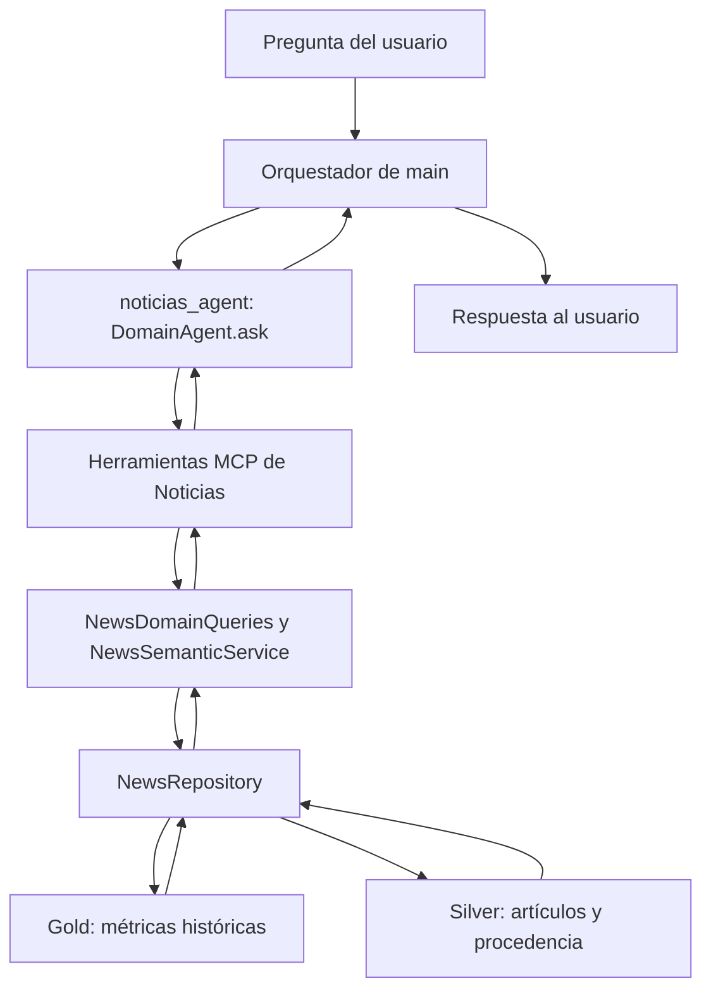

# Guía para presentar la integración de Noticias

Esta guía permite explicar y demostrar la integración en aproximadamente
8–10 minutos. Los comandos se ejecutan desde la raíz del repositorio.

## 1. Explicación inicial: qué hicimos

Puedes comenzar diciendo:

> Nuestro equipo ya tenía un sistema que procesa noticias financieras,
> calcula indicadores y conserva los artículos que respaldan esos resultados.
> El repositorio incorporó una arquitectura con un coordinador y agentes
> especializados. Adaptamos nuestro sistema para que funcione como el agente
> de Noticias: recibe consultas, usa herramientas para leer nuestros datos y
> devuelve información con fecha, fuentes y advertencias.

Un **agente de dominio** es un especialista en una parte del sistema. El de
Noticias consulta sentimiento, cobertura y titulares. El **orquestador** es el
coordinador que decide a qué especialista preguntar. Una **tool** es una función
que el agente puede llamar para obtener datos reales.

Ejemplo de pregunta: «¿Qué noticias hay de WALMEX y qué sentimiento muestran?».

## 2. Qué cambió respecto de lo anterior

| Antes | Con esta integración |
| --- | --- |
| Nuestro módulo de noticias se consultaba por separado. | Se expone como `noticias_agent`, con la interfaz de la nueva arquitectura. |
| El dominio de Noticias de `main` consultaba snapshots JSON básicos. | La adaptación consulta la capa semántica y reutiliza sus validaciones y evidencia. |
| Era necesario conocer nuestros módulos internos para usarlos. | El agente dispone de cinco herramientas con parámetros definidos. |

**Alcance de la entrega:** no se reescribieron las capas ETL. Se añadió el
adaptador que permite consultar el trabajo existente desde el nuevo agente.

La rama de esta entrega es `feature/noticias-agente-dominio` y el commit de
integración es `04c9b91`. La arquitectura de referencia está en `origin/main`,
commit `f9a9899`. Esta rama incorpora ahora los cambios de ese `main` mediante una fusión con conflictos resueltos.
Eso no publica nuestros cambios en el `main` del repositorio original; sigue haciendo falta el PR.

## 3. Cómo viaja una pregunta



Puedes explicarlo así:

> El modelo decide qué herramienta necesita. La herramienta lee datos guardados
> mediante nuestra capa semántica. El modelo recibe esos resultados para redactar
> la respuesta; los indicadores vienen de los datos, no de una estimación del modelo.

El orquestador de `main` ya utiliza este import, que conservamos:

```python
from src.agents_mcp.domains.noticias import noticias_agent
```

Luego llama a `await noticias_agent.ask(pregunta)`. Esta rama ya incluye
la base del agente, el dominio Noticias, el orquestador y los otros dominios
procedentes de `main`. La demostración local de abajo prueba el dominio y sus
herramientas. El recorrido completo con llamadas al modelo requiere acceso
y autenticación para los modelos configurados.

## 4. Archivos que conviene enseñar en el editor

Abrirlos en este orden ayuda a explicar las responsabilidades:

| Archivo | Qué mostrar al profesor |
| --- | --- |
| [`src/agents_mcp/domains/noticias.py`](../src/agents_mcp/domains/noticias.py) | `create_news_tools()` registra las herramientas; `create_news_agent()` construye el especialista y exporta `noticias_agent`. |
| [`src/semantic/domain_queries.py`](../src/semantic/domain_queries.py) | Adapta consultas, selecciona la última fecha disponible, valida el corte y anonimiza respuestas. |
| [`src/semantic/service.py`](../src/semantic/service.py) | Lógica semántica reutilizada: métricas, historial, estados e integridad de evidencia. |
| [`src/agents_mcp/domain_agent.py`](../src/agents_mcp/domain_agent.py) | Base tomada de `main`: ejecuta el ciclo del SDK y registra únicamente las tools permitidas para ese dominio. |
| [`tests/test_news_domain_agent.py`](../tests/test_news_domain_agent.py) | Pruebas de la integración con el SDK real y Parquet de prueba, sin llamar al modelo. |

En `build_options()` señalar que `tools=[]` desactiva las herramientas generales
del preset y `allowed_tools` enumera las del dominio. El diseño orienta al agente
a consultar nuestros datos mediante esas funciones.

## 5. Las cinco herramientas

| Herramienta | Pregunta que permite resolver |
| --- | --- |
| `schema_noticias` | «¿Qué datos, métricas y reglas puedes consultar?» |
| `query_noticias` | «¿Cuál es el sentimiento y la cobertura de esta empresa o tema?» |
| `historial_noticias` | «¿Cómo cambiaron los resultados entre estas fechas?» |
| `evidencia_noticias` | «¿Qué titulares y fuentes respaldan este resultado?» |
| `cobertura_noticias` | «¿Qué empresas, temas, fechas y fuentes están disponibles?» |

Parámetros útiles de `query_noticias`:

- `ticker`: empresa, por ejemplo `WALMEX`.
- `topic`: tema; se utiliza en lugar de `ticker`.
- `fecha`: día exacto en formato `YYYY-MM-DD`.
- `corte`: fecha y hora con zona horaria; limita qué información estaba disponible.
- `anonimizar`: oculta ticker y alias en la respuesta de esa herramienta.

## 6. Demostración principal: herramientas sin llamar al modelo

Esta es la demostración recomendada para empezar. Usa las herramientas reales y
los datos locales; no requiere una respuesta generada por Claude ni credenciales
para consultar APIs externas.

### Preparación

Con el entorno del proyecto activo:

```bash
source venv/bin/activate
```

Si todavía faltan dependencias:

```bash
pip install -r requirements.txt
```

Comprobar que estás mostrando la rama correcta:

```bash
git branch --show-current
git log -1 --oneline
```

Para esta demostración deben existir:

```text
data/news/gold/historical_features.parquet
data/news/silver/articles.parquet
```

### Ejecutar la demostración

Copiar el bloque completo en la terminal. Selecciona una empresa realmente
disponible y reutiliza la fecha devuelta para consultar su evidencia.

```bash
python - <<'PY'
import asyncio
import json

from src.agents_mcp.domains.noticias import create_news_tools


async def main():
    tools = {tool.name: tool for tool in create_news_tools()}

    async def mostrar(nombre, argumentos):
        reply = await tools[nombre].handler(argumentos)
        result = json.loads(reply['content'][0]['text'])
        print(f'\n--- {nombre} {argumentos} ---')
        print(json.dumps(result, ensure_ascii=False, indent=2))
        return result

    coverage = await mostrar('cobertura_noticias', {})
    tickers = (coverage.get('data') or {}).get('entities', {}).get('tickers', [])
    if not tickers:
        print('No hay empresas disponibles. Revisar el estado y las advertencias anteriores.')
        return

    ticker = 'WALMEX' if 'WALMEX' in tickers else tickers[0]
    query = await mostrar('query_noticias', {'ticker': ticker})
    await mostrar('query_noticias', {'ticker': 'TICKER_INEXISTENTE_DEMO'})

    fecha = (query.get('data') or {}).get('date_utc')
    if fecha:
        evidence = {'entity_type': 'ticker', 'entity_id': ticker, 'fecha': fecha, 'limit': 3}
        await mostrar('evidencia_noticias', evidence)
        await mostrar('evidencia_noticias', {**evidence, 'anonimizar': True})


asyncio.run(main())
PY
```

### Qué explicar mientras aparecen los resultados

1. **Cobertura:** muestra que consultamos datos existentes y conocemos su rango de fechas.
2. **Consulta de empresa:** señalar `status`, `date_utc`, `as_of`, `window_days`,
   `scoring_method`, métricas y advertencias. Si aparece `stale`, significa que el
   resultado es antiguo; se conserva su fecha real.
3. **Empresa inexistente:** debe informar `not_found` si el dataset está disponible.
   No debe inventar sentimiento. Si el dataset no existe, corresponde `data_unavailable`.
4. **Evidencia:** mostrar título, fuente, URL y fechas. Un estado
   `data_integrity_error` indica que no se pudo resolver toda la evidencia referenciada.
5. **Anonimización:** comparar ambas respuestas. El ticker y sus alias se sustituyen
   por `E1`; se omiten URLs y referencias identificadoras de la evidencia.

En la validación realizada el **6 de noviembre de 2026**, la cobertura real tenía
212 filas gold, del 30 de junio al 31 de octubre de 2026. La consulta de WALMEX
devolvió `stale` y fecha `2026-10-31`. Son resultados de aquella ejecución:
pueden cambiar al actualizar los datos.

## 7. Demostrar que no usamos información futura

Explicación para decir en voz alta:

> Una noticia o un cálculo solo puede utilizarse si ya estaba disponible en el
> momento consultado. Por ejemplo, un cálculo de las 17:00 no debe responder una
> pregunta con corte a las 12:00 del mismo día.

El adaptador filtra `as_of <= corte`; la capa semántica comprueba la
disponibilidad de la evidencia. Si se pide una fecha exacta y no hay un cálculo
disponible antes del corte, se devuelve ausencia de resultado. Sin fecha exacta,
se puede seleccionar un día anterior disponible, indicando su fecha real.

Ejecutar la prueba específica:

```bash
python -m pytest tests/test_news_domain_agent.py::test_query_cutoff_never_uses_later_calculation -v
```

Esta prueba crea datos controlados y verifica que el cálculo posterior al corte
no se utiliza. No depende de las noticias que haya el día de la presentación.

## 8. Mostrar las pruebas de la integración

```bash
python -m pytest tests/test_news_domain_agent.py -q
```

La suite contiene **14 casos** y comprueba:

- El contrato del agente y el registro de sus herramientas.
- La última fecha disponible para cada empresa y el aviso de datos antiguos.
- El respeto de fechas exactas y cortes temporales.
- La separación entre empresas y temas.
- Los errores de entrada y la ausencia de datasets.
- La recuperación de evidencia y la anonimización.
- El historial con huecos y la cobertura real.

Para incluir la lógica previa que reutilizamos:

```bash
python -m pytest tests/test_news_domain_agent.py tests/test_news_medallion.py tests/test_news_semantic.py -q
```

En la validación de esta entrega pasaron **61 pruebas**. Eso demuestra las
herramientas, contratos y consultas locales; no equivale a una prueba completa
del orquestador con llamadas al modelo. En una revisión separada se detectaron
cuatro fallos en las pruebas del servidor MCP anterior (`test_news_mcp.py`),
relacionados con sus expectativas sobre fechas y datos fijos. No forman parte
del resultado de 61 pruebas y no deben presentarse como resueltos por esta integración.

## 9. Demostración opcional con lenguaje natural

Hacerla después de la demostración local, si el entorno dispone de autenticación
del Claude Agent SDK y acceso a un modelo habilitado. Esta ejecución sí puede
utilizar el servicio del modelo.

La base heredada de `main` fija un modelo predeterminado. Para la presentación
puedes seleccionar explícitamente uno habilitado en tu cuenta, sin modificar
el código compartido:

```bash
export NEWS_DEMO_MODEL='ID_DEL_MODELO_HABILITADO_EN_TU_CUENTA'
python - <<'PY'
import asyncio
import os

from src.agents_mcp.domains.noticias import create_news_agent

agent = create_news_agent()
agent.model = os.environ['NEWS_DEMO_MODEL']
question = (
    'Consulta la cobertura disponible. Después consulta las noticias de WALMEX '
    'o de una empresa con cobertura. Indica la fecha real, sentimiento, '
    'cantidad de artículos, advertencias de antigüedad y evidencia.'
)
print(asyncio.run(agent.ask(question)))
PY
```

Esta parte demuestra el agente de Noticias conversando por sí mismo. El
orquestador y sus dominios ya están integrados. Con autenticación y modelos
accesibles, el coordinador se puede ejecutar desde la raíz:

```bash
python -m src.agents_mcp.orchestrator "Consulta las noticias y fuentes de WALMEX"
```

El registro y la delegación hacia Noticias también se verifican sin llamadas al
modelo en `tests/test_news_orchestrator_integration.py`.

## 10. Preguntas que podría hacer el profesor

**¿Esto vuelve a descargar noticias cada vez que pregunto?**

No. Las herramientas de consulta leen los datos guardados. La ingesta y el
cálculo se ejecutan por separado.

**¿Cómo sé que la respuesta tiene respaldo?**

Las métricas incluyen fecha, ventana y método. `evidencia_noticias` recupera los
artículos referenciados por gold desde silver y verifica su integridad.

**¿Qué pasa si no hay noticias o los datos son viejos?**

Se devuelve un estado explícito y advertencias. No tener cobertura no se
interpreta como sentimiento neutral. Los datos antiguos conservan su fecha.

**¿Dónde entra PySpark?**

El trabajo ETL de la práctica sigue en `src/etl/bronce/news`, `silver/news` y
`golden/news`. Esta integración es la capa de consulta del agente. Actualmente
consulta el medallion de `data/news/gold` y `data/news/silver`; las salidas de
la práctica en `data/news/noticias/golden` usan otro esquema y agregados sin
ponderación. No se conectaron como si fueran las mismas métricas ML.

**¿La anonimización elimina todos los sesgos?**

No. Sustituye ticker y alias conocidos y omite identificadores en el resultado
de las tools que admiten ese modo. Es una medida para reducir pistas sobre la
empresa; no demuestra ausencia de sesgos ni borra el nombre de la pregunta
original que recibió el modelo.

**¿Qué falta para verlo dentro del sistema completo?**

La arquitectura de `main` ya está integrada en esta rama. Falta probar el
recorrido completo con llamadas a modelos accesibles en la cuenta y aprobar
el PR para publicar los cambios en el repositorio original. La interfaz
`noticias_agent.ask()` coincide con la que utiliza el orquestador.

## 11. Frase para cerrar la presentación

> Integramos nuestro sistema de noticias como un especialista de la arquitectura
> de agentes. Reutilizamos los datos y validaciones existentes, agregamos
> herramientas de consulta y comprobamos sus fechas, evidencia y anonimización.
> La entrega conserva la interfaz que utiliza el coordinador integrado desde main.
