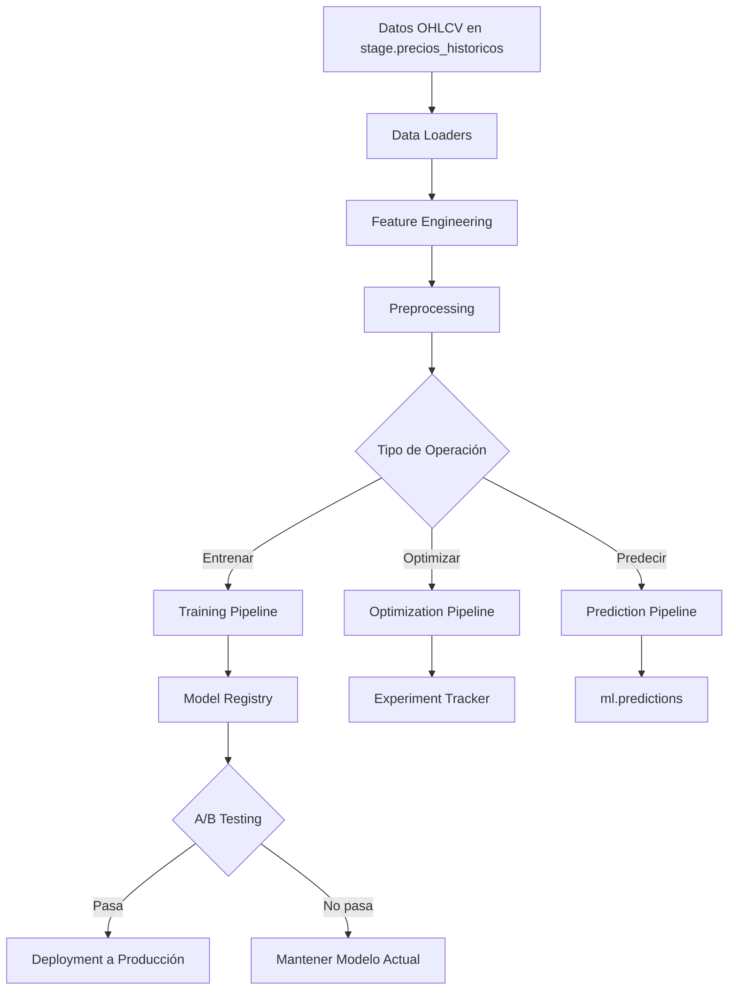

# 🔄 Flujo de Trabajo - Framework ML

## 📋 Tabla de Contenidos
1. [Flujo General](#flujo-general)
2. [Flujo de Entrenamiento Manual](#1-flujo-de-entrenamiento-manual)
3. [Flujo de Optimización con GA](#2-flujo-de-optimización-con-genetic-algorithm)
4. [Flujo de Predicción Diaria](#3-flujo-de-predicción-diaria)
5. [Flujo de Deployment con A/B Testing](#4-flujo-de-deployment-con-ab-testing)
6. [Flujo de Evaluación y Monitoreo](#5-flujo-de-evaluación-y-monitoreo)

---

## Flujo General



---

## 1. Flujo de Entrenamiento Manual

### 🎯 Objetivo
Entrenar un modelo LSTM con hyperparámetros específicos.

### 📊 Diagrama de Flujo

```
┌─────────────────────────────────────────────────────────────────┐
│                    TRAINING PIPELINE                             │
└─────────────────────────────────────────────────────────────────┘

1. CARGAR DATOS
   ┌──────────────────────────────────────┐
   │ OHLCVLoader                          │
   │ - Conecta a SQL Server               │
   │ - Query: stage.precios_historicos    │
   │ - Valida OHLC relationships          │
   └──────────────┬───────────────────────┘
                  │
                  │ DataFrame (fecha, open, high, low, close, volume)
                  ▼
2. FEATURE ENGINEERING
   ┌──────────────────────────────────────┐
   │ FeatureEngineer                      │
   │ - RSI (14)                           │
   │ - MACD (12, 26, 9)                   │
   │ - Bollinger Bands (20, 2)            │
   │ - SMA (20, 50, 200)                  │
   │ - EMA (12, 26)                       │
   │ - Returns (1d, 5d, 10d, 21d)         │
   │ - Volatility (21d)                   │
   │ - Volume features (OBV, etc.)        │
   └──────────────┬───────────────────────┘
                  │
                  │ DataFrame + 17 features técnicos
                  ▼
3. PREPROCESSING
   ┌──────────────────────────────────────┐
   │ DataScaler                           │
   │ - MinMaxScaler (0-1)                 │
   │ - Fit en train set                   │
   │ - Transform all data                 │
   └──────────────┬───────────────────────┘
                  │
                  │ Scaled features
                  ▼
   ┌──────────────────────────────────────┐
   │ SequenceGenerator                    │
   │ - Lookback window: 60 días           │
   │ - Horizon: 5, 10 o 15 días           │
   │ - Output: (samples, 60, features)    │
   └──────────────┬───────────────────────┘
                  │
                  │ X: (samples, 60, features)
                  │ y: (samples,) - target close price
                  ▼
4. SPLIT TEMPORAL
   ┌──────────────────────────────────────┐
   │ TemporalSplitter                     │
   │ - Train: Hasta T-150 días            │
   │ - Val:   T-150 a T-90 días           │
   │ - Test:  T-90 a T días               │
   │ - Sin data leakage (temporal order)  │
   └──────────────┬───────────────────────┘
                  │
                  │ X_train, X_val, X_test
                  │ y_train, y_val, y_test
                  ▼
5. CONSTRUCCIÓN DEL MODELO
   ┌──────────────────────────────────────┐
   │ LSTMModel.build()                    │
   │                                      │
   │ Input (60, features)                 │
   │    ↓                                 │
   │ LSTM Layer 1 (128 units)             │
   │    ↓                                 │
   │ Dropout (0.2)                        │
   │    ↓                                 │
   │ LSTM Layer 2 (128 units)             │
   │    ↓                                 │
   │ Dropout (0.2)                        │
   │    ↓                                 │
   │ Dense (1) - Output                   │
   │                                      │
   │ Optimizer: Adam (lr=0.001)           │
   │ Loss: MSE                            │
   └──────────────┬───────────────────────┘
                  │
                  ▼
6. ENTRENAMIENTO
   ┌──────────────────────────────────────┐
   │ LSTMModel.train()                    │
   │                                      │
   │ For epoch in range(100):             │
   │   - Train on X_train, y_train        │
   │   - Validate on X_val, y_val         │
   │   - EarlyStopping (patience=20)      │
   │   - ReduceLROnPlateau                │
   │                                      │
   │ Callbacks:                           │
   │ - ModelCheckpoint (best weights)     │
   │ - TensorBoard (logs)                 │
   └──────────────┬───────────────────────┘
                  │
                  │ Trained model + history
                  ▼
7. EVALUACIÓN
   ┌──────────────────────────────────────┐
   │ Metrics.calculate_all_metrics()      │
   │                                      │
   │ Train set:                           │
   │   - RMSE, MAE, MAPE                  │
   │   - R², Win Rate                     │
   │                                      │
   │ Validation set:                      │
   │   - RMSE, MAE, MAPE                  │
   │   - R², Win Rate                     │
   │   - Sharpe Ratio, Sortino            │
   │   - Max Drawdown, Calmar             │
   │                                      │
   │ Test set:                            │
   │   - Same metrics                     │
   └──────────────┬───────────────────────┘
                  │
                  │ Metrics dict
                  ▼
8. PERSISTENCIA
   ┌──────────────────────────────────────┐
   │ ModelRegistry.save_model()           │
   │                                      │
   │ Guardar en:                          │
   │ - models/lstm_ticker1_h5_*.h5        │
   │ - ml.model_registry (DB)             │
   │                                      │
   │ Registro:                            │
   │ - ticker_id, horizon_days            │
   │ - hyperparameters (JSON)             │
   │ - train_rmse, val_rmse, test_rmse    │
   │ - sharpe_ratio, win_rate             │
   │ - status: 'TRAINED'                  │
   └──────────────┬───────────────────────┘
                  │
                  ▼
   ┌──────────────────────────────────────┐
   │         MODELO GUARDADO              │
   │         model_id: 100                │
   └──────────────────────────────────────┘
```

### 💻 Comando
```bash
python src/ml/scripts/train_model.py \
    --ticker WALMEX \
    --horizon 5 \
    --num-layers 2 \
    --hidden-units 128 \
    --learning-rate 0.001 \
    --batch-size 32 \
    --epochs 100
```

### ⏱️ Tiempo Estimado
- **30-60 minutos** por modelo (depende de datos y hardware)

### 📊 Output
- **model_id**: ID del modelo guardado en DB
- **Métricas**: RMSE, MAE, R², Win Rate, Sharpe
- **Archivo**: `models/lstm_ticker{id}_h{horizon}_{timestamp}.h5`

---

## 2. Flujo de Optimización con Genetic Algorithm

### 🎯 Objetivo
Encontrar automáticamente los mejores hyperparámetros usando evolución genética.

### 📊 Diagrama de Flujo

```
┌─────────────────────────────────────────────────────────────────┐
│              OPTIMIZATION PIPELINE (GA)                          │
└─────────────────────────────────────────────────────────────────┘

1. CREAR EXPERIMENTO
   ┌──────────────────────────────────────┐
   │ ExperimentTracker.create_experiment()│
   │                                      │
   │ Guardar en ml.experiments:           │
   │ - ticker_id: 1                       │
   │ - horizon_days: 5                    │
   │ - experiment_type: GENETIC_ALGORITHM │
   │ - config: {search_space, ga_config}  │
   │ - status: RUNNING                    │
   └──────────────┬───────────────────────┘
                  │
                  │ experiment_id: 1
                  ▼
2. INICIALIZAR POBLACIÓN
   ┌──────────────────────────────────────┐
   │ GeneticAlgorithm.initialize_population() │
   │                                      │
   │ Crear 20 individuos aleatorios:     │
   │                                      │
   │ Individual 1:                        │
   │   genes = {                          │
   │     'num_layers': 2,                 │
   │     'hidden_units': 128,             │
   │     'dropout_rate': 0.25,            │
   │     'learning_rate': 0.0015,         │
   │     'batch_size': 32,                │
   │     'sequence_length': 60            │
   │   }                                  │
   │                                      │
   │ Individual 2:                        │
   │   genes = { ... }                    │
   │                                      │
   │ ... (x20)                            │
   └──────────────┬───────────────────────┘
                  │
                  │ Population: 20 Chromosomes
                  ▼
3. LOOP DE EVOLUCIÓN (10 Generaciones)
   ┌──────────────────────────────────────────────────────────────┐
   │  GENERACIÓN 1                                                │
   │                                                              │
   │  3.1 EVALUACIÓN DE FITNESS                                   │
   │  ┌────────────────────────────────────────────────────────┐ │
   │  │ Para cada individuo (1-20):                            │ │
   │  │                                                        │ │
   │  │   Chromosome.to_lstm_config()                          │ │
   │  │   ↓                                                    │ │
   │  │   TrainingPipeline.run(lstm_config)                    │ │
   │  │   - Cargar datos                                       │ │
   │  │   - Feature engineering                                │ │
   │  │   - Preprocessing                                      │ │
   │  │   - Split                                              │ │
   │  │   - Entrenar modelo LSTM                               │ │
   │  │   - Evaluar                                            │ │
   │  │   ↓                                                    │ │
   │  │   fitness = val_rmse                                   │ │
   │  │   (menor es mejor)                                     │ │
   │  │                                                        │ │
   │  │   O composite:                                         │ │
   │  │   fitness = 0.4*RMSE + 0.3*MAE +                       │ │
   │  │            0.2*(1/Sharpe) + 0.1*(1-WinRate)           │ │
   │  └────────────────────────────────────────────────────────┘ │
   │                                                              │
   │  Resultados Gen 1:                                           │
   │  Individual 1: fitness = 2.45                                │
   │  Individual 2: fitness = 3.12                                │
   │  ...                                                         │
   │  Individual 20: fitness = 4.87                               │
   │                                                              │
   │  Ordenar por fitness (ascendente)                            │
   │  Mejor: Individual 1 (fitness=2.45)                          │
   │                                                              │
   │  3.2 LOG A BASE DE DATOS                                     │
   │  ┌────────────────────────────────────────────────────────┐ │
   │  │ ExperimentTracker.log_generation()                     │ │
   │  │                                                        │ │
   │  │ INSERT INTO ml.experiment_generations:                 │ │
   │  │   experiment_id: 1                                     │ │
   │  │   generation_number: 1                                 │ │
   │  │   best_fitness: 2.45                                   │ │
   │  │   avg_fitness: 3.67                                    │ │
   │  │   worst_fitness: 4.87                                  │ │
   │  │   best_hyperparameters: {...}                          │ │
   │  └────────────────────────────────────────────────────────┘ │
   │                                                              │
   │  3.3 SELECCIÓN (Tournament)                                  │
   │  ┌────────────────────────────────────────────────────────┐ │
   │  │ Para crear nueva población:                            │ │
   │  │                                                        │ │
   │  │   Seleccionar padres:                                  │ │
   │  │   - Torneo de 3 individuos aleatorios                  │ │
   │  │   - Ganador: el de menor fitness                       │ │
   │  │   - Repetir para parent1 y parent2                     │ │
   │  └────────────────────────────────────────────────────────┘ │
   │                                                              │
   │  3.4 CROSSOVER                                               │
   │  ┌────────────────────────────────────────────────────────┐ │
   │  │ Chromosome.crossover(parent1, parent2)                 │ │
   │  │                                                        │ │
   │  │ Si random() < 0.7 (70% probabilidad):                  │ │
   │  │                                                        │ │
   │  │   parent1.genes = {                                    │ │
   │  │     'num_layers': 2,                                   │ │
   │  │     'hidden_units': 128,                               │ │
   │  │     'dropout_rate': 0.25                               │ │
   │  │   }                                                    │ │
   │  │                                                        │ │
   │  │   parent2.genes = {                                    │ │
   │  │     'num_layers': 3,                                   │ │
   │  │     'hidden_units': 256,                               │ │
   │  │     'dropout_rate': 0.15                               │ │
   │  │   }                                                    │ │
   │  │                                                        │ │
   │  │   Uniform crossover (50% de cada):                     │ │
   │  │                                                        │ │
   │  │   child1.genes = {                                     │ │
   │  │     'num_layers': 2,      ← parent1                    │ │
   │  │     'hidden_units': 256,  ← parent2                    │ │
   │  │     'dropout_rate': 0.25  ← parent1                    │ │
   │  │   }                                                    │ │
   │  │                                                        │ │
   │  │   child2.genes = {                                     │ │
   │  │     'num_layers': 3,      ← parent2                    │ │
   │  │     'hidden_units': 128,  ← parent1                    │ │
   │  │     'dropout_rate': 0.15  ← parent2                    │ │
   │  │   }                                                    │ │
   │  └────────────────────────────────────────────────────────┘ │
   │                                                              │
   │  3.5 MUTACIÓN                                                │
   │  ┌────────────────────────────────────────────────────────┐ │
   │  │ Chromosome.mutate(mutation_rate=0.15)                  │ │
   │  │                                                        │ │
   │  │ Para cada gene:                                        │ │
   │  │   Si random() < 0.15 (15% probabilidad):               │ │
   │  │                                                        │ │
   │  │     Si es float:                                       │ │
   │  │       Gaussian mutation                                │ │
   │  │       sigma = (max - min) * 0.1                        │ │
   │  │       new_value = random.gauss(current, sigma)         │ │
   │  │                                                        │ │
   │  │     Si es int/categorical:                             │ │
   │  │       new_value = random.choice(options)               │ │
   │  │                                                        │ │
   │  │   Ejemplo:                                             │ │
   │  │   hidden_units: 256 → 243 (mutación)                   │ │
   │  └────────────────────────────────────────────────────────┘ │
   │                                                              │
   │  3.6 ELITISMO                                                │
   │  ┌────────────────────────────────────────────────────────┐ │
   │  │ new_population = []                                    │ │
   │  │                                                        │ │
   │  │ # Pasar mejores 2 directamente                         │ │
   │  │ new_population.append(best_individual_1)               │ │
   │  │ new_population.append(best_individual_2)               │ │
   │  │                                                        │ │
   │  │ # Llenar resto con hijos                               │ │
   │  │ new_population.append(child1)                          │ │
   │  │ new_population.append(child2)                          │ │
   │  │ ... (hasta 20)                                         │ │
   │  └────────────────────────────────────────────────────────┘ │
   │                                                              │
   └──────────────────────┬───────────────────────────────────────┘
                          │
                          │ Nueva población creada
                          ▼
   ┌──────────────────────────────────────────────────────────────┐
   │  GENERACIÓN 2                                                │
   │  (Repetir pasos 3.1 - 3.6)                                   │
   └──────────────────────┬───────────────────────────────────────┘
                          │
                          ▼
                        ...
                          │
                          ▼
   ┌──────────────────────────────────────────────────────────────┐
   │  GENERACIÓN 10 (Final)                                       │
   │                                                              │
   │  Mejor individuo global encontrado:                          │
   │  fitness: 1.87                                               │
   │  genes: {                                                    │
   │    'num_layers': 3,                                          │
   │    'hidden_units': 256,                                      │
   │    'dropout_rate': 0.18,                                     │
   │    'learning_rate': 0.00087,                                 │
   │    'batch_size': 64,                                         │
   │    'sequence_length': 60,                                    │
   │    'optimizer': 'adam'                                       │
   │  }                                                           │
   └──────────────────────┬───────────────────────────────────────┘
                          │
                          ▼
4. ENTRENAR MODELO FINAL
   ┌──────────────────────────────────────┐
   │ TrainingPipeline.run()               │
   │                                      │
   │ Usar mejores hyperparámetros         │
   │ Entrenar modelo final completo       │
   │                                      │
   │ Guardar en:                          │
   │ - ml.model_registry                  │
   │   model_id: 124                      │
   │   status: TRAINED                    │
   │   val_rmse: 1.87                     │
   └──────────────┬───────────────────────┘
                  │
                  ▼
5. FINALIZAR EXPERIMENTO
   ┌──────────────────────────────────────┐
   │ ExperimentTracker.finalize_experiment() │
   │                                      │
   │ UPDATE ml.experiments:               │
   │   experiment_id: 1                   │
   │   best_model_id: 124                 │
   │   best_val_rmse: 1.87                │
   │   status: COMPLETED                  │
   │   completed_at: NOW()                │
   └──────────────┬───────────────────────┘
                  │
                  ▼
   ┌──────────────────────────────────────┐
   │     OPTIMIZACIÓN COMPLETADA          │
   │     Experimento ID: 1                │
   │     Mejor Modelo ID: 124             │
   └──────────────────────────────────────┘
```

### 💻 Comando
```bash
python src/ml/scripts/optimize_hyperparams.py \
    --ticker WALMEX \
    --horizon 5 \
    --population 20 \
    --generations 10
```

### ⏱️ Tiempo Estimado
- **3-5 horas** (20 individuos × 10 generaciones = 200 modelos entrenados)
- ~1-2 minutos por modelo × 200 = 200-400 minutos

### 📊 Output
- **experiment_id**: ID del experimento
- **best_model_id**: ID del mejor modelo encontrado
- **best_hyperparameters**: Mejores hiperparámetros
- **generation_history**: Convergencia del GA por generación

---

## 3. Flujo de Predicción Diaria

### 🎯 Objetivo
Generar predicciones para los próximos N días usando modelo en producción.

### 📊 Diagrama de Flujo

```
┌─────────────────────────────────────────────────────────────────┐
│                   PREDICTION PIPELINE                            │
└─────────────────────────────────────────────────────────────────┘

1. CARGAR MODELO EN PRODUCCIÓN
   ┌──────────────────────────────────────┐
   │ ModelRegistry.get_production_model() │
   │                                      │
   │ SELECT model_id, model_path          │
   │ FROM ml.model_registry               │
   │ WHERE ticker_id = 1                  │
   │   AND horizon_days = 5               │
   │   AND status = 'PRODUCTION'          │
   │ ORDER BY trained_at DESC             │
   │ LIMIT 1                              │
   │                                      │
   │ Cargar desde:                        │
   │ models/lstm_ticker1_h5_*.h5          │
   └──────────────┬───────────────────────┘
                  │
                  │ model, config, model_id
                  ▼
2. OBTENER DATOS RECIENTES
   ┌──────────────────────────────────────┐
   │ OHLCVLoader.load_data()              │
   │                                      │
   │ Últimos 180 días (6 meses):          │
   │ - Suficiente para indicadores        │
   │ - Suficiente para secuencia (60)     │
   │                                      │
   │ SELECT fecha, open, high, low,       │
   │        close, volume                 │
   │ FROM stage.precios_historicos        │
   │ WHERE ticker_id = 1                  │
   │   AND fecha >= DATEADD(day, -180,    │
   │                        GETDATE())    │
   │ ORDER BY fecha ASC                   │
   └──────────────┬───────────────────────┘
                  │
                  │ 180 registros
                  ▼
3. FEATURE ENGINEERING
   ┌──────────────────────────────────────┐
   │ FeatureEngineer.add_all_features()   │
   │                                      │
   │ Calcular indicadores técnicos:       │
   │ - RSI, MACD, Bollinger               │
   │ - SMA, EMA                           │
   │ - Returns, Volatility                │
   │ - Volume features                    │
   │                                      │
   │ dropna() → Últimos ~160 válidos      │
   └──────────────┬───────────────────────┘
                  │
                  │ Data con features
                  ▼
4. CREAR ÚLTIMA SECUENCIA
   ┌──────────────────────────────────────┐
   │ DataScaler + SequenceGenerator       │
   │                                      │
   │ Escalar features (MinMax 0-1)        │
   │                                      │
   │ Extraer últimos 60 días:             │
   │ last_sequence = data[-60:]           │
   │                                      │
   │ Shape: (1, 60, num_features)         │
   │                                      │
   │ Ejemplo:                             │
   │ [                                    │
   │   [close, open, high, low, ...],  # Día T-59
   │   [close, open, high, low, ...],  # Día T-58
   │   ...                                │
   │   [close, open, high, low, ...]   # Día T (hoy)
   │ ]                                    │
   └──────────────┬───────────────────────┘
                  │
                  │ last_sequence: (1, 60, features)
                  ▼
5. PREDECIR ITERATIVAMENTE
   ┌──────────────────────────────────────┐
   │ for day in range(horizon_days):      │
   │                                      │
   │   DAY 1:                             │
   │   ┌────────────────────────────────┐ │
   │   │ prediction = model.predict(    │ │
   │   │     last_sequence               │ │
   │   │ )                               │ │
   │   │                                 │ │
   │   │ pred_day1 = 58.45               │ │
   │   │                                 │ │
   │   │ # Actualizar secuencia          │ │
   │   │ last_sequence = roll(-1)        │ │
   │   │ last_sequence[-1, 0] = 58.45    │ │
   │   └────────────────────────────────┘ │
   │                                      │
   │   DAY 2:                             │
   │   ┌────────────────────────────────┐ │
   │   │ prediction = model.predict(    │ │
   │   │     last_sequence               │ │
   │   │ )                               │ │
   │   │                                 │ │
   │   │ pred_day2 = 58.92               │ │
   │   │                                 │ │
   │   │ last_sequence = roll(-1)        │ │
   │   │ last_sequence[-1, 0] = 58.92    │ │
   │   └────────────────────────────────┘ │
   │                                      │
   │   ... (hasta horizon_days)           │
   │                                      │
   │ predictions = [58.45, 58.92, 59.12,  │
   │                59.34, 59.51]         │
   └──────────────┬───────────────────────┘
                  │
                  │ predictions: List[float]
                  ▼
6. GUARDAR EN BASE DE DATOS
   ┌──────────────────────────────────────┐
   │ Para cada predicción:                │
   │                                      │
   │ DAY 1:                               │
   │   prediction_date = 2025-12-29       │
   │   target_date = 2025-12-30           │
   │   days_ahead = 1                     │
   │   predicted_close = 58.45            │
   │   actual_close = NULL                │
   │                                      │
   │   MERGE INTO ml.predictions          │
   │   (model_id, ticker_id,              │
   │    prediction_date, target_date,     │
   │    days_ahead, predicted_close)      │
   │                                      │
   │ DAY 2:                               │
   │   prediction_date = 2025-12-29       │
   │   target_date = 2025-12-31           │
   │   days_ahead = 2                     │
   │   predicted_close = 58.92            │
   │   actual_close = NULL                │
   │                                      │
   │ ... (DAY 3, 4, 5)                    │
   └──────────────┬───────────────────────┘
                  │
                  ▼
   ┌──────────────────────────────────────┐
   │    PREDICCIONES GUARDADAS            │
   │                                      │
   │    Día +1: $58.45                    │
   │    Día +2: $58.92                    │
   │    Día +3: $59.12                    │
   │    Día +4: $59.34                    │
   │    Día +5: $59.51                    │
   └──────────────────────────────────────┘

7. ACTUALIZACIÓN DIARIA CON VALORES REALES
   ┌──────────────────────────────────────┐
   │ (Al día siguiente, ejecutar SP)      │
   │                                      │
   │ EXEC ml.sp_update_predictions_       │
   │      with_actuals                    │
   │                                      │
   │ UPDATE p                             │
   │ SET p.actual_close = ph.close        │
   │ FROM ml.predictions p                │
   │ JOIN stage.precios_historicos ph     │
   │   ON p.ticker_id = ph.ticker_id      │
   │   AND p.target_date = ph.fecha       │
   │ WHERE p.actual_close IS NULL         │
   │                                      │
   │ Resultado:                           │
   │ prediction_date | target_date |      │
   │     predicted   | actual             │
   │ 2025-12-28      | 2025-12-29  |      │
   │     57.80       | 58.12              │
   └──────────────────────────────────────┘
```

### 💻 Comando
```bash
# Usar modelo en producción
python src/ml/scripts/predict_next_days.py --ticker WALMEX --horizon 5

# O usar modelo específico
python src/ml/scripts/predict_next_days.py --ticker WALMEX --horizon 5 --model-id 124
```

### ⏱️ Tiempo Estimado
- **< 1 minuto** por ticker/horizon

### 📊 Output
- Predicciones para próximos 5, 10 o 15 días
- Guardadas en `ml.predictions`

---

## 4. Flujo de Deployment con A/B Testing

### 🎯 Objetivo
Comparar modelo actual vs challenger y decidir deployment basado en datos.

### 📊 Diagrama de Flujo

```
┌─────────────────────────────────────────────────────────────────┐
│                  DEPLOYMENT PIPELINE (A/B)                       │
└─────────────────────────────────────────────────────────────────┘

1. VALIDACIÓN DE MODELOS
   ┌──────────────────────────────────────┐
   │ Verificar que ambos modelos:         │
   │ - Existen en ml.model_registry       │
   │ - Son del mismo ticker_id            │
   │ - Son del mismo horizon_days         │
   │                                      │
   │ Modelo A (Producción): ID 100        │
   │ Modelo B (Challenger): ID 124        │
   │                                      │
   │ ticker_id: 1 (WALMEX)                │
   │ horizon_days: 5                      │
   └──────────────┬───────────────────────┘
                  │
                  │ Validación OK
                  ▼
2. OBTENER PREDICCIONES DE AMBOS MODELOS
   ┌──────────────────────────────────────┐
   │ Query últimos 30 días:               │
   │                                      │
   │ MODELO A (Producción):               │
   │ SELECT target_date, predicted_close, │
   │        actual_close                  │
   │ FROM ml.predictions                  │
   │ WHERE model_id = 100                 │
   │   AND ticker_id = 1                  │
   │   AND prediction_date >= '2024-11-29'│
   │   AND actual_close IS NOT NULL       │
   │                                      │
   │ Resultados:                          │
   │ Date       | Pred_A | Actual         │
   │ 2024-12-01 | 58.20  | 58.45          │
   │ 2024-12-02 | 58.50  | 58.12          │
   │ 2024-12-03 | 58.15  | 58.78          │
   │ ... (30 días)                        │
   │                                      │
   │ MODELO B (Challenger):               │
   │ Same query con model_id = 124        │
   │                                      │
   │ Date       | Pred_B | Actual         │
   │ 2024-12-01 | 58.38  | 58.45          │
   │ 2024-12-02 | 58.18  | 58.12          │
   │ 2024-12-03 | 58.71  | 58.78          │
   │ ... (30 días)                        │
   └──────────────┬───────────────────────┘
                  │
                  │ Alinear por fechas comunes
                  ▼
3. CALCULAR MÉTRICAS
   ┌──────────────────────────────────────┐
   │ Metrics.calculate_all_metrics()      │
   │                                      │
   │ MODELO A:                            │
   │   RMSE: 2.45                         │
   │   MAE: 1.89                          │
   │   Win Rate: 62.3%                    │
   │   Sharpe Ratio: 1.42                 │
   │   R²: 0.78                           │
   │                                      │
   │ MODELO B:                            │
   │   RMSE: 2.12  ← 13.5% mejor          │
   │   MAE: 1.65   ← 12.7% mejor          │
   │   Win Rate: 65.1%  ← 2.8% mejor      │
   │   Sharpe Ratio: 1.61  ← 13.4% mejor  │
   │   R²: 0.83                           │
   └──────────────┬───────────────────────┘
                  │
                  │ Métricas calculadas
                  ▼
4. PRUEBAS ESTADÍSTICAS
   ┌──────────────────────────────────────┐
   │ ABTester.compare_models()            │
   │                                      │
   │ 4.1 PAIRED T-TEST                    │
   │ ┌────────────────────────────────┐   │
   │ │ errors_a = |actual - pred_a|   │   │
   │ │ errors_b = |actual - pred_b|   │   │
   │ │                                │   │
   │ │ t_stat, p_value = ttest_rel(   │   │
   │ │     errors_a, errors_b         │   │
   │ │ )                              │   │
   │ │                                │   │
   │ │ Resultado:                     │   │
   │ │ t-statistic: 2.87              │   │
   │ │ p-value: 0.0043 < 0.05 ✅      │   │
   │ │ → Significativo                │   │
   │ └────────────────────────────────┘   │
   │                                      │
   │ 4.2 WILCOXON SIGNED-RANK             │
   │ ┌────────────────────────────────┐   │
   │ │ Non-parametric test            │   │
   │ │                                │   │
   │ │ w_stat, w_pvalue = wilcoxon(   │   │
   │ │     errors_a, errors_b         │   │
   │ │ )                              │   │
   │ │                                │   │
   │ │ Resultado:                     │   │
   │ │ W-statistic: 234.5             │   │
   │ │ p-value: 0.0067 < 0.05 ✅      │   │
   │ │ → Significativo                │   │
   │ └────────────────────────────────┘   │
   └──────────────┬───────────────────────┘
                  │
                  │ Pruebas estadísticas OK
                  ▼
5. DECISIÓN DE DEPLOYMENT
   ┌──────────────────────────────────────┐
   │ Criterios (todos deben cumplirse):   │
   │                                      │
   │ ✅ RMSE mejora >= 5%                 │
   │    13.5% > 5% → PASA                 │
   │                                      │
   │ ✅ MAE mejora >= 5%                  │
   │    12.7% > 5% → PASA                 │
   │                                      │
   │ ✅ Win Rate mejora >= 2% (absoluto)  │
   │    2.8% > 2% → PASA                  │
   │                                      │
   │ ✅ Sharpe mejora >= 10%              │
   │    13.4% > 10% → PASA                │
   │                                      │
   │ ✅ Significancia estadística         │
   │    p-value < 0.05 → PASA             │
   │                                      │
   │ ━━━━━━━━━━━━━━━━━━━━━━━━━━━━━━━━━━  │
   │ DECISIÓN: DESPLEGAR MODELO B         │
   │ ━━━━━━━━━━━━━━━━━━━━━━━━━━━━━━━━━━  │
   └──────────────┬───────────────────────┘
                  │
                  │ Deploy approved
                  ▼
6. EJECUTAR DEPLOYMENT
   ┌──────────────────────────────────────┐
   │ 6.1 Cambiar status de modelos        │
   │ ┌────────────────────────────────┐   │
   │ │ UPDATE ml.model_registry       │   │
   │ │ SET status = 'DEPRECATED'      │   │
   │ │ WHERE model_id = 100           │   │
   │ │                                │   │
   │ │ UPDATE ml.model_registry       │   │
   │ │ SET status = 'PRODUCTION'      │   │
   │ │ WHERE model_id = 124           │   │
   │ └────────────────────────────────┘   │
   │                                      │
   │ 6.2 Registrar A/B test               │
   │ ┌────────────────────────────────┐   │
   │ │ INSERT INTO ml.ab_tests (      │   │
   │ │   model_a_id: 100,             │   │
   │ │   model_b_id: 124,             │   │
   │ │   ticker_id: 1,                │   │
   │ │   test_start_date: 2024-11-29, │   │
   │ │   test_end_date: 2024-12-29,   │   │
   │ │   model_a_rmse: 2.45,          │   │
   │ │   model_b_rmse: 2.12,          │   │
   │ │   model_a_mae: 1.89,           │   │
   │ │   model_b_mae: 1.65,           │   │
   │ │   model_a_win_rate: 0.623,     │   │
   │ │   model_b_win_rate: 0.651,     │   │
   │ │   winner: 'MODEL_B',           │   │
   │ │   deployed: TRUE               │   │
   │ │ )                              │   │
   │ └────────────────────────────────┘   │
   └──────────────┬───────────────────────┘
                  │
                  ▼
   ┌──────────────────────────────────────┐
   │  ✅ DEPLOYMENT COMPLETADO             │
   │                                      │
   │  Modelo 124 ahora en PRODUCCIÓN      │
   │  Modelo 100 marcado como DEPRECATED  │
   │                                      │
   │  Próximas predicciones usarán        │
   │  modelo 124 automáticamente          │
   └──────────────────────────────────────┘
```

### 💻 Comando
```bash
python src/ml/scripts/deploy_model.py \
    --current-model-id 100 \
    --challenger-id 124 \
    --test-days 30
```

### ⏱️ Tiempo Estimado
- **< 5 minutos**

### 📊 Output
- Comparación detallada de métricas
- Pruebas estadísticas (t-test, Wilcoxon)
- Decisión: DEPLOY o MANTENER
- Registro en `ml.ab_tests`

---

## 5. Flujo de Evaluación y Monitoreo

### 🎯 Objetivo
Evaluar modelo con backtesting walk-forward para simular producción.

### 📊 Diagrama de Flujo

```
┌─────────────────────────────────────────────────────────────────┐
│                  EVALUATION PIPELINE                             │
└─────────────────────────────────────────────────────────────────┘

1. CARGAR MODELO
   ┌──────────────────────────────────────┐
   │ ModelRegistry.load_model(124)        │
   │                                      │
   │ Cargar:                              │
   │ - Archivo .h5                        │
   │ - Hyperparameters (JSON)             │
   │ - Config LSTM                        │
   └──────────────┬───────────────────────┘
                  │
                  ▼
2. CARGAR DATOS HISTÓRICOS
   ┌──────────────────────────────────────┐
   │ OHLCVLoader.load_data()              │
   │                                      │
   │ Últimos 2 años (o desde start_date)  │
   │                                      │
   │ ~500 registros de trading days       │
   └──────────────┬───────────────────────┘
                  │
                  │ Historical data
                  ▼
3. WALK-FORWARD BACKTESTING
   ┌──────────────────────────────────────────────────────────────┐
   │ Backtester.run_backtest()                                    │
   │                                                              │
   │ Configuración:                                               │
   │ - initial_train_days: 252 (1 año)                            │
   │ - retrain_frequency: 21 (mensual)                            │
   │ - test_days: 5 (horizon)                                     │
   │                                                              │
   │ ┌──────────────────────────────────────────────────────────┐ │
   │ │ VENTANA 1                                                │ │
   │ │                                                          │ │
   │ │ Train: Día 1 → Día 252                                   │ │
   │ │ Test:  Día 253 → Día 257 (5 días)                        │ │
   │ │                                                          │ │
   │ │ 1. Entrenar modelo con días 1-252                        │ │
   │ │ 2. Predecir días 253-257                                 │ │
   │ │ 3. Comparar con valores reales                           │ │
   │ │ 4. Calcular métricas ventana 1                           │ │
   │ │                                                          │ │
   │ │ Resultados:                                              │ │
   │ │   RMSE: 2.34                                             │ │
   │ │   Win Rate: 60%                                          │ │
   │ └──────────────────────────────────────────────────────────┘ │
   │                                                              │
   │ ┌──────────────────────────────────────────────────────────┐ │
   │ │ VENTANA 2                                                │ │
   │ │                                                          │ │
   │ │ Train: Día 1 → Día 273 (252 + 21)                        │ │
   │ │ Test:  Día 274 → Día 278                                 │ │
   │ │                                                          │ │
   │ │ 1. Re-entrenar con días 1-273                            │ │
   │ │ 2. Predecir días 274-278                                 │ │
   │ │ 3. Comparar con reales                                   │ │
   │ │ 4. Calcular métricas ventana 2                           │ │
   │ │                                                          │ │
   │ │ Resultados:                                              │ │
   │ │   RMSE: 2.18                                             │ │
   │ │   Win Rate: 64%                                          │ │
   │ └──────────────────────────────────────────────────────────┘ │
   │                                                              │
   │ ... (continuar cada 21 días)                                 │
   │                                                              │
   │ ┌──────────────────────────────────────────────────────────┐ │
   │ │ VENTANA N (Final)                                        │ │
   │ │                                                          │ │
   │ │ Train: Día 1 → Día 490                                   │ │
   │ │ Test:  Día 491 → Día 495                                 │ │
   │ │                                                          │ │
   │ │ Resultados:                                              │ │
   │ │   RMSE: 2.05                                             │ │
   │ │   Win Rate: 68%                                          │ │
   │ └──────────────────────────────────────────────────────────┘ │
   └──────────────────────┬───────────────────────────────────────┘
                          │
                          │ Todas las ventanas evaluadas
                          ▼
4. AGREGAR MÉTRICAS
   ┌──────────────────────────────────────┐
   │ Combinar todas las predicciones:     │
   │                                      │
   │ all_predictions: [pred1, pred2, ...] │
   │ all_actuals: [actual1, actual2, ...] │
   │                                      │
   │ Calcular métricas globales:          │
   │                                      │
   │ RMSE global: 2.19                    │
   │ MAE global: 1.72                     │
   │ R² global: 0.81                      │
   │ Win Rate: 64.2%                      │
   │ Sharpe Ratio: 1.54                   │
   │ Max Drawdown: -8.3%                  │
   │                                      │
   │ Estabilidad:                         │
   │ RMSE std entre ventanas: 0.12        │
   │ (Baja std = modelo estable)          │
   └──────────────┬───────────────────────┘
                  │
                  ▼
5. VISUALIZACIÓN
   ┌──────────────────────────────────────┐
   │ Backtester.plot_results()            │
   │                                      │
   │ Generar gráfico:                     │
   │ backtest_model_124.png               │
   │                                      │
   │ Plot 1: Predicciones vs Actual       │
   │ ┌────────────────────────────────┐   │
   │ │     ^                          │   │
   │ │  P  │  ∿∿∿ Actual (blue)       │   │
   │ │  R  │  --- Predicted (red)     │   │
   │ │  E  │                          │   │
   │ │  C  │                          │   │
   │ │  I  │                          │   │
   │ │  O  │                          │   │
   │ │     └──────────────────────>   │   │
   │ │           TIEMPO               │   │
   │ └────────────────────────────────┘   │
   │                                      │
   │ Plot 2: Error %                      │
   │ ┌────────────────────────────────┐   │
   │ │  %  │     ∿∿∿∿∿∿∿             │   │
   │ │     │   ──────────── 0%        │   │
   │ │  E  │  ∿∿∿∿∿∿∿∿                │   │
   │ │  R  │                          │   │
   │ │  R  │                          │   │
   │ │  O  └──────────────────────>   │   │
   │ │           TIEMPO               │   │
   │ └────────────────────────────────┘   │
   └──────────────┬───────────────────────┘
                  │
                  ▼
   ┌──────────────────────────────────────┐
   │    EVALUACIÓN COMPLETADA             │
   │                                      │
   │    RMSE: 2.19                        │
   │    Win Rate: 64.2%                   │
   │    Sharpe: 1.54                      │
   │    Estabilidad: ✅ Buena             │
   └──────────────────────────────────────┘
```

### 💻 Comando
```bash
python src/ml/scripts/evaluate_model.py --model-id 124

# O desde fecha específica
python src/ml/scripts/evaluate_model.py --model-id 124 --start-date 2024-11-01
```

### ⏱️ Tiempo Estimado
- **5-15 minutos** (depende de datos históricos)

### 📊 Output
- Métricas agregadas de todas las ventanas
- Gráfico de predicciones vs actuales
- Gráfico de error temporal
- Archivo PNG guardado

---

## 📊 Resumen de Flujos

| Flujo | Propósito | Frecuencia | Tiempo | Script |
|-------|-----------|------------|--------|--------|
| **Training** | Entrenar modelo con hyperparams específicos | Ad-hoc | 30-60 min | `train_model.py` |
| **Optimization** | Encontrar mejores hyperparams con GA | Mensual/Trimestral | 3-5 horas | `optimize_hyperparams.py` |
| **Prediction** | Generar predicciones diarias | Diario (5 PM) | < 1 min | `predict_next_days.py` |
| **Deployment** | A/B testing y deployment | Cuando hay challenger | < 5 min | `deploy_model.py` |
| **Evaluation** | Backtesting walk-forward | Ad-hoc | 5-15 min | `evaluate_model.py` |

---

## 🔄 Ciclo de Vida Completo

```
1. SETUP INICIAL (Una vez)
   ↓
   Ejecutar SQL schema (ml.*)
   ↓
   Entrenar primer modelo manual
   ↓
   Marcar como PRODUCTION
   
2. OPERACIÓN DIARIA
   ↓
   5:00 PM: Actualizar predictions con actuals (SP)
   ↓
   5:05 PM: Generar nuevas predicciones
   ↓
   Guardar en ml.predictions
   
3. OPTIMIZACIÓN (Mensual/Trimestral)
   ↓
   Ejecutar GA (optimize_hyperparams.py)
   ↓
   Obtener mejor modelo (challenger)
   ↓
   A/B Testing vs modelo en producción
   ↓
   Si pasa: Deploy a producción
   ↓
   Si no pasa: Mantener modelo actual
   
4. MONITOREO (Continuo)
   ↓
   Queries SQL para ver performance
   ↓
   ml.v_prediction_performance
   ↓
   Alertas si degradación > X%
```

---

## 🎯 Decisiones Basadas en Datos

### Cuándo RE-OPTIMIZAR con GA:

```sql
-- Si performance degrada > 10% vs histórico
SELECT 
    AVG(ABS(predicted_close - actual_close) / actual_close) as avg_error_pct
FROM ml.predictions
WHERE model_id = (SELECT model_id FROM ml.v_production_models WHERE ticker_id = 1)
  AND actual_close IS NOT NULL
  AND prediction_date >= DATEADD(day, -30, GETDATE())
HAVING AVG(ABS(predicted_close - actual_close) / actual_close) > 0.10
```

### Cuándo DEPRECAR modelo:

```sql
-- Si Win Rate < 55% en últimos 30 días
SELECT 
    model_id,
    SUM(CASE WHEN SIGN(actual_close - LAG(actual_close) OVER (ORDER BY target_date)) = 
                   SIGN(predicted_close - LAG(predicted_close) OVER (ORDER BY target_date))
             THEN 1 ELSE 0 END) * 1.0 / COUNT(*) as win_rate
FROM ml.predictions
WHERE actual_close IS NOT NULL
  AND prediction_date >= DATEADD(day, -30, GETDATE())
GROUP BY model_id
HAVING win_rate < 0.55
```

---

## 📚 Siguiente: Documentación de APIs

Ver `ML_FRAMEWORK_ARCHITECTURE.md` para:
- Clases y métodos detallados
- Estructura de base de datos
- Configuraciones YAML
- Mejores prácticas
