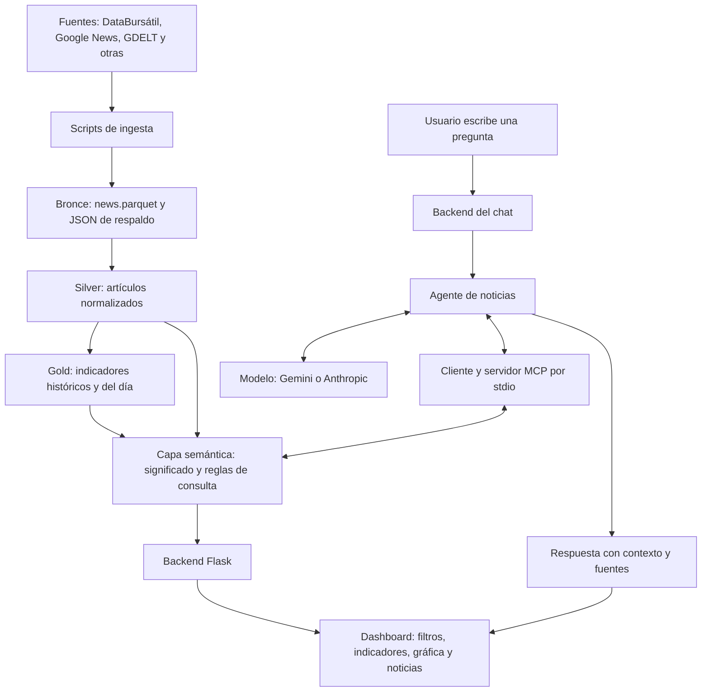

# Proyecto: dashboard de noticias con agente de IA

## Qué hace el proyecto

El sistema recopila noticias financieras y temáticas, las organiza en capas de datos y calcula indicadores. El usuario puede explorar esos resultados en un dashboard o preguntar a un agente que consulta información y evidencia mediante MCP.

Hay dos etapas independientes: **preparar los datos** y **consultarlos**. Abrir el dashboard o enviar una pregunta no ejecuta la ingesta ni actualiza las noticias automáticamente.

## Esquema general



**El panel visual consulta la capa semántica directamente. El chat consulta esa misma capa a través del agente y MCP.** No todas las consultas del dashboard pasan por el modelo de IA.

## 1. Medallion: preparar y almacenar los datos

La arquitectura medallion separa tres responsabilidades: conservar lo recibido, organizar artículos y producir indicadores.

| Capa | Qué hace | Archivo principal | Qué representa una fila |
|---|---|---|---|
| Bronce | Conserva los registros disponibles tal como llegan a la capa, sin limpieza adicional ni deduplicación de artículos. | `data/news/bronze/news.parquet` | Una noticia por fuente, captura y posición dentro de la captura. |
| Silver | Limpia texto, interpreta fechas, identifica artículos y conserva sus asociaciones y observaciones. | `data/news/silver/articles.parquet` | Un artículo asociado a una empresa o tema en una captura. |
| Gold histórica | Conserva indicadores calculados para distintas fechas UTC. | `data/news/gold/historical_features.parquet` | Resultado de una fecha, empresa y tema con evidencia disponible. |
| Gold del día | Mantiene los indicadores de hoy UTC. | `data/news/gold/today_features.parquet` | Resultado de hoy para una empresa o tema. |

### Bronce: evidencia recibida

- Reúne todas las fuentes en `news.parquet`.
- Conserva noticias repetidas entre capturas y campos originales en `raw_payload`.
- Registra fuente, captura, titular, texto, enlace y fecha de publicación sin interpretar.
- Conserva JSON de respaldo por fuente y captura, con el sobre completo.
- No asigna sentimiento ni elimina noticias por parecer repetidas.

«Original» significa lo disponible en la frontera de captura: algunos conectores ya extraen campos de la fuente. No implica disponer siempre del HTML, XML o cuerpo HTTP completo.

### Silver: artículos utilizables

- Unifica los nombres de columnas y limpia HTML, entidades y espacios.
- Genera `article_id` para reconocer artículos y conserva `batch_id` para identificar sus capturas.
- Distingue publicación, captura y disponibilidad para los cálculos.
- Deja `text` nulo si no existe un resumen distinto del titular.
- Deja `sentiment` nulo cuando no recibió una evaluación; cero proporcionado por la fuente representa neutralidad.
- Conserva observaciones de capturas diferentes para auditoría; elimina duplicados exactos dentro de un lote.

Las noticias de Trump se conservan como tema `trump`, sin atribuirlas automáticamente a empresas. Las asociaciones empresariales de los conectores son coincidencias informativas, no pruebas de impacto económico.

### Gold: indicadores listos para consultar

Calcula sentimiento, volumen ponderado, cambio de sentimiento, dispersión, relevancia y sentimiento ESG. Usa la última observación disponible por artículo y asociación, sin contar varias veces un artículo por aparecer en distintas capturas.

| Campo de contexto | Para qué sirve |
|---|---|
| `date` | Identifica el día UTC del resultado. |
| `as_of` | Indica el corte exacto de información utilizado. |
| `window_days` | Registra cuántos días cubre la ventana reciente. |
| `scoring_method` | Indica cómo se calculó el sentimiento; actualmente `keywords`. |
| `article_ids` | Identifica los artículos utilizados, incluidas la ventana reciente y la anterior. |
| `batch_ids` | Identifica las capturas de las observaciones utilizadas. |

La tabla histórica conserva fechas anteriores; la del día se reemplaza al actualizar hoy. Un recálculo histórico no sustituye los resultados de hoy. `daily_features.parquet` se conserva como copia compatible de la histórica, y `gold/latest.json` exporta la tabla del día.

**La tabla del día contiene indicadores calculados hoy, normalmente con noticias de los últimos siete días. No significa que todas se publicaron hoy.**

Implementación: [src/data/news_medallion.py](src/data/news_medallion.py).

## 2. Capa semántica: significado y consultas consistentes

La capa semántica lee gold y silver y transforma sus columnas técnicas en respuestas comprensibles. No es otra copia de los datos ni un modelo de lenguaje.

| Responsabilidad | Ejemplo |
|---|---|
| Traducir métricas | `news_sent_score` se presenta como `sentimiento_general`. |
| Seleccionar datos | Buscar WALMEX en una fecha exacta o el tema Trump sin mezclarlo con empresas. |
| Aplicar reglas temporales | Distinguir hoy UTC, una fecha histórica y el corte disponible. |
| Tratar ausencias | Diferenciar no evaluado, sin noticias, neutral y desactualizado. |
| Comprobar comparabilidad | Evitar comparar ventanas o métodos diferentes. |
| Recuperar evidencia | Resolver artículos y capturas que respaldan un resultado gold. |

Sus respuestas incluyen estado, consulta, datos, advertencias y procedencia. Por ejemplo, una respuesta puede ser `ok`, `not_found`, `stale` o `data_integrity_error`.

El sentimiento positivo no se interpreta como probabilidad de subida; la dispersión del sentimiento no se presenta como volatilidad del precio. Los conteos de ventanas superpuestas no se suman como noticias únicas.

Archivos:

- [service.py](src/semantic/service.py): consultas y reglas de negocio.
- [repository.py](src/semantic/repository.py): lectura y validación de los Parquet.
- [metrics.json](src/semantic/metrics.json): definiciones de métricas.
- [interpretation.py](src/semantic/interpretation.py): interpretación de los resultados.
- [models.py](src/semantic/models.py): validación de entradas y contratos de respuesta.

## 3. MCP: herramientas para que el agente consulte

MCP conecta al agente con operaciones de consulta. El servidor expone herramientas; la capa semántica resuelve su significado y obtiene los datos.

| Herramienta | Qué consulta |
|---|---|
| `ver_noticias` | Indicadores de una empresa para hoy o una fecha histórica. |
| `consultar_tema_noticias` | Indicadores de temas como `trump` o `market`. |
| `consultar_historial_noticias` | Serie de indicadores por empresa o tema. |
| `consultar_evidencia_noticias` | Artículos, enlaces y procedencia del resultado. |
| `resumen_noticias` | Evolución de una empresa y conteo único de artículos cuando la evidencia se puede resolver. |
| `comparar_noticias` | Comparación entre empresas con fecha, ventana y método compatibles. |
| `listar_tickers_noticias` | Empresas, temas, fechas y fuentes disponibles. |

El MCP es de solo lectura: no descarga noticias, recalcula indicadores ni modifica los Parquet. Utiliza el protocolo por `stdio`, mediante la entrada y salida de un proceso local, sin necesitar un puerto MCP adicional.

Implementación: [src/mcp/server.py](src/mcp/server.py).

## 4. Agente y modelo: entender preguntas y coordinar herramientas

El agente de noticias utiliza el framework propio de `src/agent`. El modelo entiende la pregunta y propone qué herramientas consultar; el código del agente ejecuta esas solicitudes y devuelve sus resultados al modelo.

Secuencia:

1. Recibe la pregunta, la selección del panel y un historial breve de conversación.
2. Abre una sesión con el servidor MCP y obtiene sus herramientas disponibles.
3. Envía al modelo las instrucciones, la pregunta y las definiciones de herramientas.
4. El modelo solicita una herramienta con argumentos estructurados.
5. El agente la invoca mediante el cliente MCP.
6. La respuesta de la capa semántica vuelve al modelo.
7. El ciclo puede repetirse hasta redactar la respuesta final, dentro de los límites configurados.
8. El dashboard muestra la respuesta y enlaces de evidencia recuperados.

El modelo no lee directamente los Parquet. Tampoco decide por sí mismo ejecutar código arbitrario: solo puede solicitar las herramientas permitidas por el agente.

La configuración permite elegir Gemini o Anthropic. Las claves permanecen en el backend; no se envían al navegador. No hay cambio automático de proveedor cuando una solicitud falla.

Archivos:

- [src/agent/news.py](src/agent/news.py): agente y ciclo de herramientas MCP.
- [src/agent/news_chat.py](src/agent/news_chat.py): selector de proveedor y adaptador del chat.
- [src/agent/chat.py](src/agent/chat.py): adaptador Anthropic reutilizado.

Este agente analiza noticias. No ejecuta órdenes ni aplica las reglas de cartera del agente inversor.

## 5. Dashboard: interacción con el usuario

El dashboard tiene dos rutas de consulta.

### Ruta A: panel visual, sin IA

```text
Seleccionar empresa/tema y fecha
    → Navegador solicita datos al backend Flask
    → Flask llama a la capa semántica
    → La capa semántica lee gold y, para evidencia, silver
    → Flask devuelve JSON
    → El navegador dibuja tarjetas, gráfica y noticias
```

Esta ruta funciona sin clave de Gemini o Anthropic. No utiliza MCP porque el backend puede llamar directamente al servicio Python.

| Endpoint | Uso |
|---|---|
| `GET /api/coverage` | Cargar empresas, temas y cobertura. |
| `GET /api/snapshot` | Consultar los indicadores seleccionados. |
| `GET /api/history` | Obtener la serie para la gráfica. |
| `GET /api/evidence` | Recuperar artículos paginados y fuentes. |
| `GET /api/agent` | Consultar disponibilidad del chat y proveedor configurado. |

### Ruta B: chat con agente y MCP

```text
Escribir una pregunta
    → POST /api/chat
    → Backend valida pregunta, contexto e historial
    → Agente conversa con Gemini o Anthropic
    → Modelo solicita herramientas
    → Agente las ejecuta mediante MCP
    → MCP consulta la capa semántica
    → Resultados y evidencia vuelven al modelo
    → Dashboard muestra explicación y enlaces
```

Por tanto, no existe una única cadena obligatoria «medallion → semántica → MCP → dashboard» para todas las acciones. MCP interviene en las consultas del agente; el panel visual accede directamente a la capa semántica.

Si Gemini no responde, el chat informa un timeout. Ese fallo no significa que las tablas o las gráficas estén dañadas: el panel puede seguir consultando los datos locales.

Archivos del dashboard:

- [src/dashboard/news.py](src/dashboard/news.py): backend y rutas.
- [news.html](src/dashboard/templates/news.html): estructura de la interfaz.
- [news.js](src/dashboard/static/news.js): filtros, gráfica, evidencia y chat.
- [news.css](src/dashboard/static/news.css): presentación adaptable a escritorio y móvil.

## 6. Ejemplo completo: explicar las noticias de WALMEX

| Paso | Componente | Qué sucede |
|---|---|---|
| 1 | Ingesta | Descarga noticias de las fuentes disponibles. |
| 2 | Bronce | Conserva cada registro con su captura y fuente. |
| 3 | Silver | Limpia y organiza los artículos; conserva asociaciones y fechas. |
| 4 | Gold | Calcula los indicadores de WALMEX con información disponible al corte. |
| 5 | Dashboard visual | Muestra sentimiento, número de artículos, histórico y evidencia mediante la capa semántica. |
| 6 | Usuario | Pregunta «¿Qué noticias explican este sentimiento?». |
| 7 | Agente y modelo | Solicitan indicadores y evidencia mediante herramientas MCP. |
| 8 | MCP y semántica | Resuelven la consulta respetando la asociación, fecha, ventana y lotes de origen. |
| 9 | Modelo | Redacta una explicación a partir de los resultados; debe reconocer límites y separar hechos de inferencias. |
| 10 | Dashboard | Presenta la respuesta junto con enlaces recuperados para verificarla. |

Las respuestas del modelo pueden contener errores. La procedencia permite contrastarlas con los artículos; no convierte automáticamente la interpretación en un hecho.

## 7. Actualización y ejecución

### Preparar o actualizar noticias

```bash
venv/bin/python scripts/databursatil_news_snapshot.py
venv/bin/python scripts/fetch_news.py --universe bmv
venv/bin/python scripts/ingesta_trump.py
```

Cada comando utiliza las ingestas y capas correspondientes. No todos consultan las mismas fuentes.

### Reprocesar datos existentes, sin descargar noticias

```bash
# Reconstruir el Parquet bronce desde los JSON de captura.
venv/bin/python scripts/build_news_medallion.py --bronze-only

# Reprocesar capturas y reconstruir silver y los cortes históricos gold.
venv/bin/python scripts/build_news_medallion.py --replay --rebuild-gold-history
```

### Abrir el dashboard

```bash
venv/bin/python scripts/run_news_dashboard.py
```

Dirección local: `http://127.0.0.1:8050/`.

Para activar el chat, configurar `.env` y reiniciar:

```dotenv
NEWS_CHAT_PROVIDER=gemini
GEMINI_API_KEY=tu_clave
# Opcional: un modelo habilitado en la cuenta.
# GEMINI_CHAT_MODEL=tu_modelo
```

Para elegir Anthropic en otra ocasión:

```dotenv
NEWS_CHAT_PROVIDER=anthropic
ANTHROPIC_API_KEY=tu_clave
# ANTHROPIC_MODEL=tu_modelo
```

«Actualizar vista» consulta nuevamente los archivos existentes. No ejecuta estos comandos de ingesta ni solicita al modelo generar nuevos indicadores.

## 8. Responsabilidad de cada componente en una frase

| Componente | Responsabilidad |
|---|---|
| Ingesta | Obtener noticias de las fuentes. |
| Bronce | Conservar lo recibido. |
| Silver | Organizar artículos y observaciones. |
| Gold | Calcular y guardar indicadores. |
| Capa semántica | Dar significado y aplicar reglas de consulta. |
| MCP | Exponer consultas como herramientas para el agente. |
| Agente | Coordinar preguntas, herramientas y respuestas del modelo. |
| Modelo de IA | Interpretar la pregunta y redactar una respuesta contextualizada. |
| Backend Flask | Conectar la interfaz con servicios y agente. |
| Dashboard | Permitir explorar datos y conversar con el agente. |

Detalles adicionales: [medallion](docs/NEWS_MEDALLION.md), [capa semántica](docs/NEWS_SEMANTIC.md), [MCP](docs/MCP_NOTICIAS.md) y [dashboard](docs/NEWS_DASHBOARD.md).
